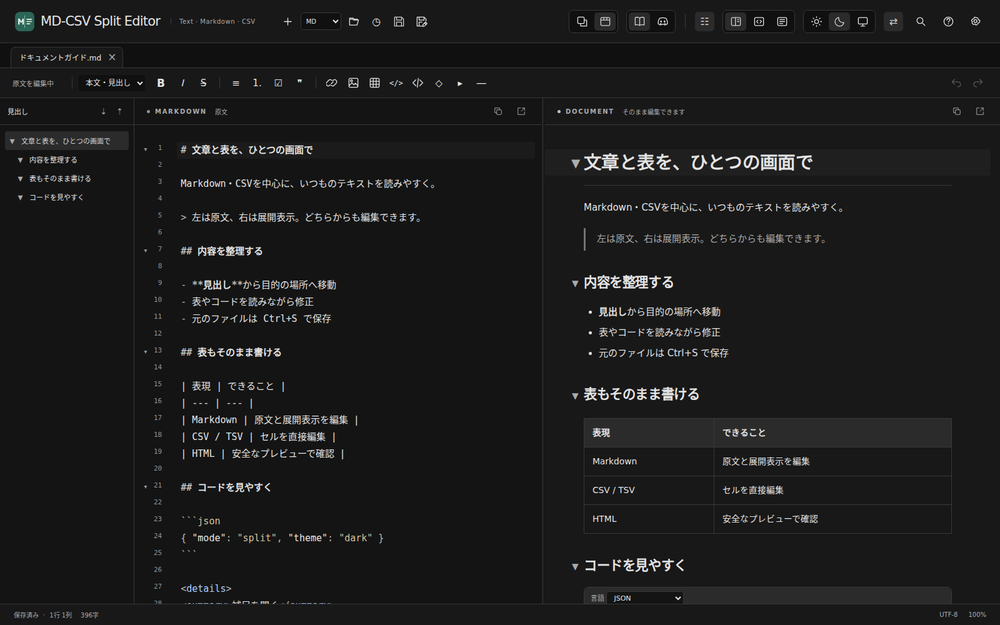
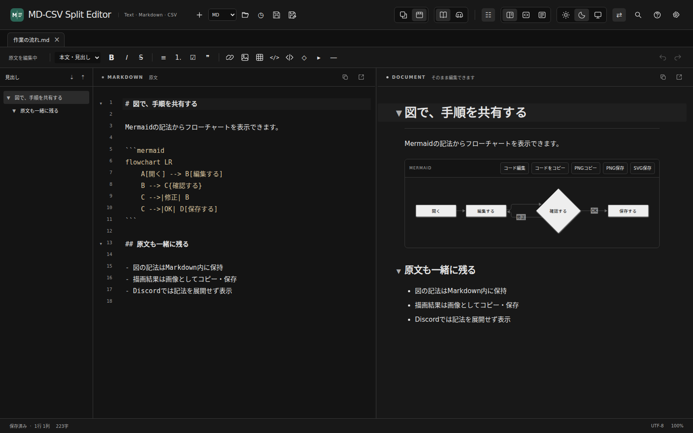
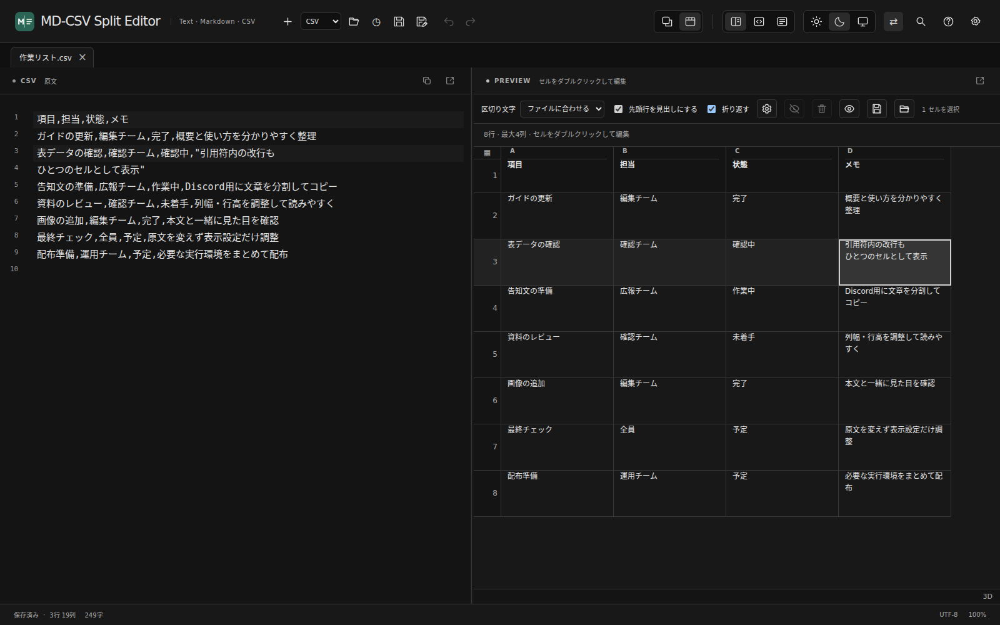
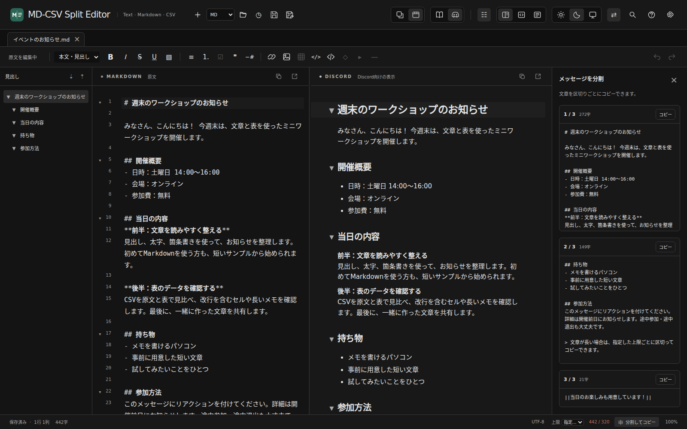
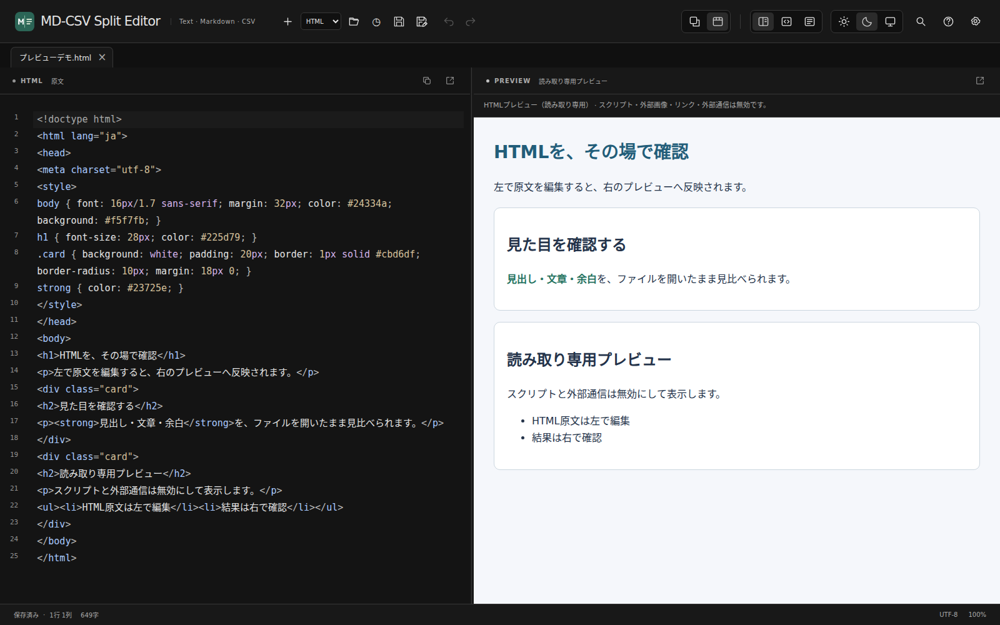
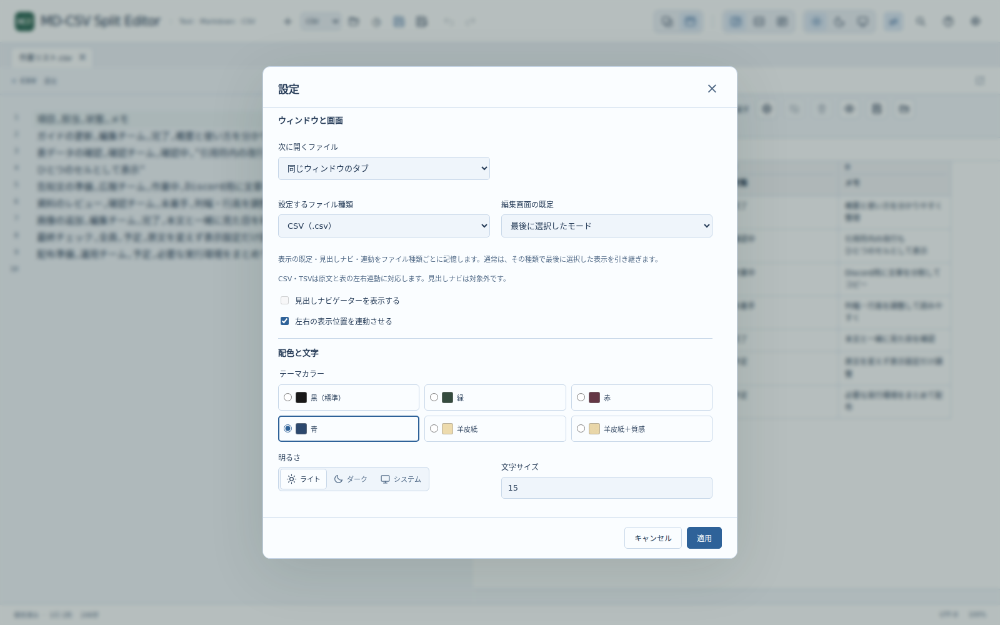

# MD-CSV Split Editor

**Markdownは文章として、CSVは表として。原文と見比べながら、どちらからでも編集できるWindows用テキストエディターです。**

READMEやメモの作成、AIから受け取ったMarkdownの確認、Discordの告知づくり、CSVの内容確認と修正を、ひとつのアプリで扱えます。TXT・JSON・コード類の編集と、HTMLのプレビューにも対応します。

[ダウンロード](#download) · [対応ファイル](#formats) · [Markdown](#markdown) · [CSV・TSV](#csv-tsv) · [Discord](#discord) · [表示と設定](#appearance)

## こんな作業に使えます

| やりたいこと | 使える機能 |
|---|---|
| Markdownを読みながら直す | 原文・展開表示の両方から編集し、変更をリアルタイムに反映 |
| 長いREADMEや技術資料を整理する | 見出しナビ、節の折りたたみ、左右スクロール連動 |
| CSVの長い文章や複数行のセルを確認する | 表表示、列幅・行高の変更、折り返し、行・列の固定 |
| CSVの不要な行・列をまとめて処理する | Ctrl／Shiftで複数選択し、非表示・削除。削除はUndo可能 |
| Discordへ長文を投稿する | Discordモード、文字数表示、上限に合わせた分割と1件ずつのコピー |
| コード・図・画像入りの文書を作る | 言語別のコード表示、Mermaid、画像の貼り付け・ドラッグ＆ドロップ |
| 文章やデータをまとめて修正する | 検索・置換、正規表現、使い方のサンプル一覧 |
| 手元のテキストを開く | TXT・JSON・コード類、複数の文字コード、最近開いたファイル |

## ダウンロード

**公開配布の準備中です。現在、この公開用ページからダウンロードできるセットアップはありません。**

公開後は、バージョンごとの **Setup.exe 1本** からインストールできます。Pythonなどを別途用意する必要はありません。.NETと固定版WebView2 Runtimeを同梱し、セットアップ中の追加ダウンロードは行いません。

<!-- downloads:start -->
| バージョン | 対応環境 | ダウンロード | 主な内容 |
|---|---|---|---|
| 1.0.0 | Windows 10／11・x64 | <kbd>配布準備中</kbd> | Markdown・CSVの両側編集、CSVの左右連動、種類別表示設定 |
<!-- downloads:end -->

### インストールの流れ

1. 公開されたSetup.exeを起動します。
2. アプリ専用のインストール先を選びます。
3. スタートメニュー、デスクトップ、Windowsのアプリ一覧、.mdを開く候補への登録など、必要な項目を選びます。
4. .mdの既定アプリにする場合は、Windowsの「既定のアプリ」から選択します。

文書はインストール先とは別の場所へ保存してください。初回は、画像・表・図・コードなどを試せる編集可能な使い方ガイドが開きます。後からヘルプの **「編集できるガイドを開く」** でも表示できます。

## 対応ファイル

| ファイル | 原文編集 | プレビュー側の操作 | 見出しナビ | 左右スクロール連動 |
|---|---|---|---|---|
| Markdown（.md・.markdown） | ○ | 展開した文章を直接編集 | ○ | ○ |
| CSV（.csv） | ○ | 表のセルを直接編集 | — | ○ |
| TSV（.tsv） | ○ | 表のセルを直接編集 | — | ○ |
| HTML（.html・.htm） | ○ | 読み取り専用プレビュー | — | — |
| TXT・JSON・XML・コード・設定類 | ○ | 原文のみの表示 | — | — |

ファイルはフォルダーアイコンや **Ctrl+O** で開けます。本文の上だけでなく、ヘッダーやタブの上へドラッグ＆ドロップしても開きます。新規作成ボタンの隣では、作るファイルの種類を選べます。

元ファイルへの保存は **Ctrl+S**、別名保存は **Ctrl+Shift+S** です。別名保存の最初の保存先は、Windowsの「ドキュメント」です。ファイルを開いただけでは保存確認を出しません。

## Markdownを見ながら書く

左には記法が見える原文、右には見出し・装飾・リスト・表などを展開した文章を表示します。どちらで編集しても同じ文書に反映し、上部の共通ツールバーは最後に操作した側へ適用されます。

- 見出し、太字、斜体、打ち消し線、箇条書き、番号付きリスト、引用、リンク、表などを挿入できます。
- 変更していない部分の改行・空行・Markdown記法をできるだけ維持しながら、編集箇所を反映します。
- リストの空項目で再度Enterを押すと通常の文章へ戻ります。項目の先頭ではTabで字下げ、Shift+TabやBackspaceで戻せます。
- 見出しナビから目的の節へ移動し、見出し単位で折りたためます。折りたたんでも原文は削除しません。
- 左右のスクロールを対応する段落へ連動させられます。現在行の強調はスクロールと別で、クリックだけで反対側の表示位置を動かしません。

上部の3つの表示アイコンから **左右分割／原文のみ／展開のみ** を切り替えます。各ペインの矢印アイコンでは、その側を別ウィンドウへ表示できます。別コピーではなく、同じ文書の編集・保存・Undoを共有します。

### コード・図・画像も扱う

コードブロックはHTML、CSS、JavaScript、Pythonなどの言語とプリセットを選べます。対応する言語は色分けして表示し、コードを実行しません。`details`による折りたたみ表示にも対応します。

Mermaidの図は、描画した図を通常の文章と同じように直接書き換えるのではなく、**元のコードを編集して描き直します**。.mdには図の画像ではなくMermaidコードを保存します。図そのものを渡したい場合は、PNGコピー・PNG保存・SVG保存を使えます。

画像はボタンから選ぶほか、画像ファイルのドラッグやスクリーンショットの貼り付けで追加できます。追加した画像は文書保存時に、隣の **「文書名.assets」** フォルダーへ保存し、相対パスで参照します。

## CSV・TSVを表で確認・修正する

CSV・TSVは原文と表の両方から編集できます。カンマ・タブ・セミコロンの区切りを選べ、引用符で囲まれたカンマや改行は1つの値として扱います。絵文字を含む文章も表示できます。

### セルを編集する

セルをダブルクリックするか、選択して **Enter／F2** で編集を始めます。Enterで確定、Shift+Enterでセル内改行、Tabで次のセル、Shift+Tabで前のセルへ移動します。Escapeでは編集中の変更を取り消せます。

変更は原文へ反映し、変更していないセルの書き方や改行を保持します。原文側のコピーアイコンではCSVの原文をコピーでき、セル編集中は通常のCtrl+Cで文字をコピーできます。

### 見やすくしてから、必要な範囲を操作する

| 操作 | 使い方 |
|---|---|
| 行・列を選ぶ | 行番号欄・列見出しをクリック。Ctrlで追加・解除、Shiftで範囲選択 |
| 全選択 | 左上のボタン、または表にフォーカスしてCtrl+A。セル編集中はセル内の文字を全選択 |
| 幅・高さを変える | 境界をマウスでドラッグ。「表示設定」ではpx指定も可能 |
| 折り返しを変える | 「折り返す」を切り替え。長い文章を複数行にするか、横へ読める形にするかを選択 |
| 固定する | 先頭から指定した行・列を固定。最大100行・50列 |
| 隠す・戻す | 選択した行・列を非表示にし、解除して再表示 |
| 削除する | 複数の行・列をまとめて削除。原文も変更し、Ctrl+Zで元へ戻せる |
| 文字の位置を変える | セル・行・列へ、左右中央・上下中央の配置を指定 |
| 長い行の短いセルを追う | 縦位置を「画面表示に合わせる」にすると、スクロール中の画面内で内容を確認しやすい |

列名と列番号を同時に表示し、列番号は英字・数字から選べます。右下には、選択した位置を `20A:28AC`、数字なら `20-1:28-29` のように表示します。飛び飛びの選択には「複数範囲」を添えます。アイコンの意味は、マウスを重ねたときの説明で確認できます。

### 原文と表の位置を合わせる

**⇄ボタン** で双方向のスクロール連動をオン・オフできます。セル内に改行がある場合もCSVのレコード単位で対応付け、現在の操作行を反対側でも強調します。行やセルをクリックしただけでは、反対側をスクロールしません。別ウィンドウ同士でも同じ設定を使います。

列幅・行高・配置・非表示などは、通常は文書を開いている間だけ保持します。残したい場合は **「表示設定を保存」** で、CSV・TSVの隣へ **`元のファイル名.mdsplit-view.json`** を保存し、後から読み込めます。このファイルにCSV本文は含めません。

大きな表では表示を続けるか確認し、続行すると100行・50列単位のページ表示で扱います。データの読み込み・解析に必要な時間とメモリは内容とPCに依存します。CSVはテキスト形式のデータとして扱い、数式は計算しません。Excelの書式を保持する機能ではありません。

## Discord向けの文章を整える

Markdownをそのまま貼り付けたとき、Discordでは使えない表や図まで展開して見えてしまうことがあります。**Discordモード** では、対応しない表・Mermaid・detailsなどを原文のまま表示し、投稿用の文章を確認しやすくします。

1. 上部のDiscordアイコンへ切り替えます。このモードはウィンドウ内のMarkdownタブに適用します。
2. 下部の上限を、投稿先で使える **2,000／4,000／任意の文字数** に合わせます。
3. 「分割してコピー」で、区切りと文字数を確認します。
4. 各カードのコピーを押し、1件ずつ順番に貼り付けます。

| コピーする場所 | コピー内容 |
|---|---|
| 左の原文 | Markdown原文 |
| 右の通常モード | 書式付きの文章 |
| 右のDiscordモード | 投稿用のMarkdown |

分割時はコードフェンスなどの区切りも考慮します。モード変更・分割コピーで、保存する原文を書き換えることはありません。Discordの表示を完全に再現するものではないため、投稿後の見え方はDiscordでも確認してください。Mermaidの図を送りたい場合は、通常モードでPNGをコピーし、画像として貼り付けます。

## テキスト・コード・HTMLにも使う

TXT・JSON・XML・JavaScript・CSS・Python・YAML・ログ・設定ファイルなどは、原文のみの画面で開きます。Markdownの装飾ツールバーや見出しナビを出さず、通常のテキスト編集・検索・置換・Undoを使えます。対応するコードは種類に応じて色分けします。

HTMLは原文を編集すると右のプレビューへ反映します。プレビュー内のJavaScriptは実行せず、外部の画像・スタイルなども読み込まないため、外部素材を使ったWebページの完全な再現には向きません。HTMLの編集は原文側で行います。

### 文字コードを選んで開く・保存する

下部の文字コード表示から、**UTF-8（BOMなし・あり）、UTF-16／UTF-32（LE・BE）、Shift JIS（CP932）、EUC-JP、ISO-2022-JP、Windows-1252、GB18030、Big5、CP949**を選べます。

「この文字コードで開き直す」と「次の保存からこの文字コードを使う」は別の操作です。自動判定は推定のため、文字化けしたときは上書きする前に、文字コードを指定して開き直してください。表現できない文字は「?」に置き換えて保存せず、エラーとして知らせます。

## ファイル種類ごとに見やすくする

設定の **「設定するファイル種類」** で、Markdown・CSV・TSV・HTMLそれぞれの設定を選べます。

- **編集画面の既定**：通常は、その種類で最後に選んだ表示を次回以降も使います。左右分割・原文のみ・展開のみを固定の既定にすることもできます。
- **見出しナビゲーター**：Markdownで表示・非表示を記憶します。
- **左右連動**：Markdown・CSV・TSVで、種類ごとにオン・オフを記憶します。

固定の既定を選んだ場合は、次に開く同じ種類の文書でその指定を優先します。すでに開いている各タブは、それぞれの表示を維持します。未対応の項目は設定画面で無効表示になります。

黒・緑・赤・青・羊皮紙・羊皮紙＋質感の6テーマを選べます。配色と明るさは選んだ直後に確認でき、「キャンセル」で元へ戻ります。上部の太陽・月・モニターは、ライト・ダーク・システムの3択です。羊皮紙では明るさを固定し、明暗トグルを無効にします。

改行・全角スペース・Tab・半角スペースは、記号の表示、色、濃さをそれぞれ設定できます。表示用の記号は文書の保存・コピーには入りません。

## 検索とショートカット

Ctrl+Fで検索、Ctrl+Hで置換します。「正規表現」をオンにすると、改行、数字、URL、文字の並べ替えなどをまとめて扱えます。アプリ内のサンプル一覧から式を選べます。Windows版は.NETの正規表現で、サクラエディタと共通する基本記法を使えますが、完全互換ではありません。

| 操作 | キー |
|---|---|
| 開く／保存／名前を付けて保存 | Ctrl+O／Ctrl+S／Ctrl+Shift+S |
| 新規作成／タブを閉じる | Ctrl+N／Ctrl+W |
| 元に戻す／やり直す | Ctrl+Z／Ctrl+Y |
| 検索／置換／次の一致 | Ctrl+F／Ctrl+H／F3 |
| Markdownの太字／斜体／リンク | Ctrl+B／Ctrl+I／Ctrl+K |
| リンクをブラウザーで開く | Ctrl+クリック／ダブルクリック |

タブで開くか別ウィンドウで開くかは、上部の2択アイコンで切り替えます。変更は次に開くファイルから適用し、すでに開いているタブの配置は変えません。最近開いたファイルは時計アイコンから選べます。

## 更新とアンインストール

起動時の更新確認は **なし／毎回／1日／7日／30日／指定した日数** から選べます。公開されたGitHub Releasesへバックグラウンドで問い合わせ、新しい版がある場合に確認します。更新を選んだ後にダウンロードし、署名・サイズ・SHA-256などの検証に成功したファイルだけを使用します。

更新先へ接続できない場合は、小さな通知で知らせて編集を続けられます。セットアップ自体はネットワークへ接続しませんが、アプリの更新確認・ダウンロード、URL画像の表示、外部リンクを開く操作では通信が発生します。

本体・設定・履歴・キャッシュはインストール先にまとめています。Windowsのアプリ一覧やショートカット・関連付けの登録も消す場合は、先に **Uninstall.exe** またはWindowsのアンインストール操作を使ってください。インストール先の外に保存した文書や画像は削除対象にしません。

## 確認状況と資料

掲載画像は、サンプル文書を使って実装済みの画面を撮影したものです。Windowsのインストーラー画面ではありません。Windows実機でのインストール・更新・修復・削除、Microsoft IME、ネイティブのダイアログや別ウィンドウは、引き続き確認が必要です。配布候補のWindows発行元署名（Authenticode）は未付与です。

[変更履歴](CHANGELOG.md) · [安全性と更新処理](SECURITY.md) · [検証結果](VALIDATION.md) · [ビルド・配布手順](docs/Releasing.md) · [第三者ライセンス](THIRD_PARTY_NOTICES.txt)

本体の配布・ソース利用に関するライセンスは公開前に確定します。第三者コンポーネントのライセンス・著作権表示は、同梱の資料を参照してください。
