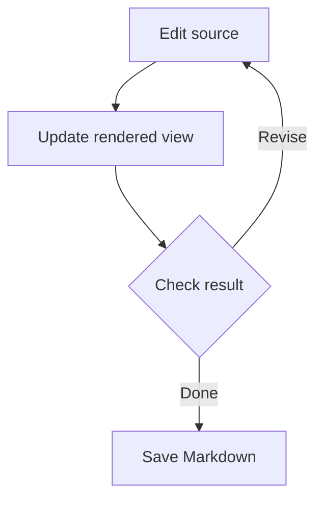

# Getting started with MD-CSV Split Editor

This text editor is designed for Markdown and CSV. It also edits text, configuration and code files and previews HTML.

In this editable guide, the left side shows the **Markdown source** and the right side shows the **rendered document**. Edit either side and the other updates. Try changing the note below. You can reopen a fresh copy from Help at any time.

> Today's note: check the shopping list before leaving.

**Three things to try**

1. Type on either side and check the change on the other side.
2. Select some text and press the bold button. The shared toolbar acts on the side you last used.
3. Press **Ctrl+S** or the save icon to save your own Markdown file.

This guide opens as an untitled document. If you do not need your changes, discard them when closing. An example screenshot appears near the end of the guide.

## 1. Formatting and line breaks

Select this paragraph and try the toolbar. Use **bold**, *italic*, ~~strikethrough~~ and `inline code`. Ctrl+B and Ctrl+I toggle bold and italic.

> This is a quotation.
>
> You can edit **bold text** inside it too.

Choose paragraph or heading levels 1–6 from the toolbar. Headings also appear in the heading navigator.

### A smaller heading

You can edit this text directly on the right. In normal mode, Enter starts a paragraph and Shift+Enter inserts a line break. Settings control whether a single source line break is shown on the right; Discord mode displays single line breaks.

Insert a horizontal rule with the toolbar:

---

## 2. Lists and checkboxes

- Buy vegetables
  - Carrots
  - Onions
- Put things away

1. Open a document
   1. Check both views
   2. Edit the relevant text
2. Save the document

- [ ] Edit the shopping list
- [x] Check both views

In normal mode, click a checkbox to toggle it. Press Enter at the end of a list item to create another; press Enter in an empty item to return to ordinary text. At the start of an item, Tab indents it and Shift+Tab or Backspace outdents it. Tab in body text inserts a tab character. Use the list buttons to remove or change the list type.

## 3. Tabs, spaces and invisible characters

This example contains real tabs and a full-width space. Turn on the display of tabs, full-width spaces, spaces and line breaks in Settings to see them in both views.

```text
Name	Plan	Status
Document	Review	Done
A full-width　space appears here.
An ordinary space appears here.
```

Display markers are not included in the saved or copied text. You can also adjust source wrapping, font size and single line break display.

## 4. Editing tables

| Item | Quantity | Status |
| --- | ---: | --- |
| Carrots | 2 | To buy |
| Onions | 1 | Bought |

Edit cells on the right. Right-click a table to add or remove rows and columns. Tab and Shift+Tab move between cells; Ctrl+Tab inserts a tab character. In Discord mode, tables remain as Markdown syntax instead of being rendered as tables.

## 5. Code and syntax highlighting

Use the code block button to choose a language and example, such as HTML, CSS, JavaScript or Python. Change the language at the top of the block.

```html
<article>
  <h1>Today's note</h1>
  <p><strong>Check</strong> the things you need.</p>
</article>
```

```javascript
const items = ['carrots', 'onions'];
console.log(items.join(', '));
```

Code and HTML are treated as text, not executed. Edit the examples and observe highlighting and the source view.

## 6. Mermaid diagrams and collapsible sections



Use the diagram's code editor to edit Mermaid. Copy or save a PNG, or save an SVG, when you need an image. The Markdown file retains the diagram code.

<details>
<summary>Open and edit this collapsible section</summary>

You can edit this text on the right too.

- Add a note
- The content remains in the document when collapsed

</details>

Discord does not render Mermaid or details blocks. To share a diagram, copy a PNG in normal mode and paste the image into Discord.

## 7. Opening links

Try [this example link](https://example.com/) or https://example.com/. Use **Ctrl+click** or **double-click** to open a link in your default browser; a normal click places the cursor. Ctrl+K or the link button adds a link to selected text. Opening a link requires an Internet connection.

## 8. Layout, headings and scrolling

- Choose split, source only or rendered only with the three-way toolbar control; drag the divider to resize the panes.
- The last layout is normally remembered separately by file type. You can also choose a fixed default in Settings.
- Open the heading navigator to jump to headings. Collapse a section from its heading or the navigator; collapsing does not delete source text.
- Detach the source or rendered view into a separate window; edits remain synchronized.
- The corresponding current line is highlighted on the other side. Linked scrolling follows actual scrolls rather than cursor movement. It can be toggled and is remembered by file type. Markdown, CSV and TSV are supported.
- Choose whether newly opened files use tabs in the current window or a separate window in Settings or the window/tab control.

## 9. Themes and display

Choose black, green, red, blue, parchment or textured parchment. Preview the colors immediately in Settings. Use the light, dark and system toggle; system follows Windows. Parchment uses its own colors. Font size and source wrapping are adjustable.

Try switching to parchment and back. The underlying Markdown remains unchanged.

## 10. Find, replace and regular expressions

Press Ctrl+F to find and Ctrl+H to replace. F3 finds the next match and Shift+F3 the previous one. Enable regular expressions only when needed; examples are available in the interface.

| Goal | Find | Replace |
| --- | --- | --- |
| Find numbers | `\d+` | Leave unchanged |
| Change level 2 headings to level 3 | `^## (.+)$` | `### $1` |
| Remove trailing spaces and tabs | `[ \t]+(?=\r?$)` | Empty |

Practice text: order 123, quantity 2, date 2026. The Windows app uses .NET regular expressions. Ctrl+Z undoes a mistaken replacement.

## 11. Discord mode and split copy

Use the normal/Discord toolbar icons to switch modes for all tabs in a window without changing the source.

**Example announcement:** *important plans* and ~~cancelled plans~~.

- 19:00 Meet
  - Check equipment
- 19:10 Start

__Discord underline__ and ||spoiler text||.

-# A small Discord text example.

Tables, Mermaid and details remain as syntax in Discord mode. Some Discord formatting may differ, so check the actual post in Discord. For long posts, choose a 2,000-character, 4,000-character or custom limit and use split copy. Review each card and copy each part. Added code fences may make split copies differ slightly from the original.

**Note:** This guide embeds an image, so do not paste the whole guide into Discord. Copy the example announcement into a new document to practice.

## 12. Images and Save As

Paste a screenshot with Ctrl+V, drag and drop an image, or select one with the image button. Double-click an image to edit its reference and alternative text.

Added images are normally saved beside the document in a **document-name.assets** folder and referenced using relative paths. Share the Markdown file and that folder together. **Save As** (Ctrl+Shift+S) copies managed images to the new document's assets folder. Cancelling does not discard your edits.

The sample screenshot below is embedded directly in this guide, so it remains available when the guide is copied or saved by itself. Keep its long data line unchanged if you want to retain it.

## 13. Recent files, associations and updates

Use the clock icon to open one of the 20 most recent files. Clearing history does not delete the files.

To open .md files by double-clicking, register the application as a candidate in Settings and choose MD-CSV Split Editor in Windows Default apps.

Set the update-check interval in Settings. The app checks GitHub Releases and, after confirmation, downloads and verifies an update. The offline installer does not require additional downloads.

## 14. Saving, recovery and character encoding

Save or Ctrl+S writes to the original document; recovery data is separate. The app asks before overwriting a file changed by another application.

Use the encoding indicator to select UTF-8, UTF-16/32, Shift JIS (CP932), EUC-JP and other encodings. Choosing the encoding for the next save, reopening the current file, and opening another file are separate operations. UTF-16/32 saves can include a BOM. UTF-8 is convenient for new documents.

The app checks unsaved documents before updating. Settings and recovery data are preserved, but save important documents in your own folder. Use Uninstall.exe to remove Windows registrations before deleting the application folder; store your documents elsewhere.

## 15. Other file types

Choose MD, TXT, HTML, JSON, CSV, TSV or XML next to the New button, then press New or Ctrl+N. Open existing files with Ctrl+O, the folder button or drag and drop. The default first save location is Windows Documents.

- **TXT, JSON, XML, JS, CSS, YAML and logs:** edit source text, with syntax highlighting where available.
- **HTML:** edit source on the left and inspect the read-only preview on the right. Preview scripts do not run and external images and styles are not loaded.
- **CSV and TSV:** edit source or table cells. Double-click a cell to edit; Enter finishes, Shift+Enter inserts a line break and Tab moves to the next cell. Comma, tab and semicolon delimiters are supported, including quoted delimiters and line breaks. Large tables may display a confirmation and use paged table views; source editing remains available.

Select rows and columns with their headers, using Ctrl and Shift for multiple selection. Drag boundaries or use display settings for widths and heights, wrapping, freezing, hiding and alignment. Deleting rows or columns changes the data and can be undone with Ctrl+Z. Display settings alone do not change the CSV: save or load them separately with a `.mdsplit-view.json` file.

If text appears corrupted, choose an encoding from the indicator and select whether to reopen, open another file or use it for the next save. Encoding detection cannot always identify old files without a BOM; inspect text before overwriting.

## 16. Example image

This example shows the editor with a heading list, source and Mermaid diagram. The image is embedded in the guide.


## 17. Keyboard shortcuts

| Action | Keys |
| --- | --- |
| Open, save, Save As | Ctrl+O, Ctrl+S, Ctrl+Shift+S |
| New, close tab | Ctrl+N, Ctrl+W |
| Bold, italic, link | Ctrl+B, Ctrl+I, Ctrl+K |
| Undo, redo | Ctrl+Z, Ctrl+Y |
| Find, replace | Ctrl+F, Ctrl+H |
| Next, previous match | F3, Shift+F3 |
| Open a link | Ctrl+click, double-click |

When you are ready, close this guide and create a new document. You can reopen a fresh editable guide from Help.
